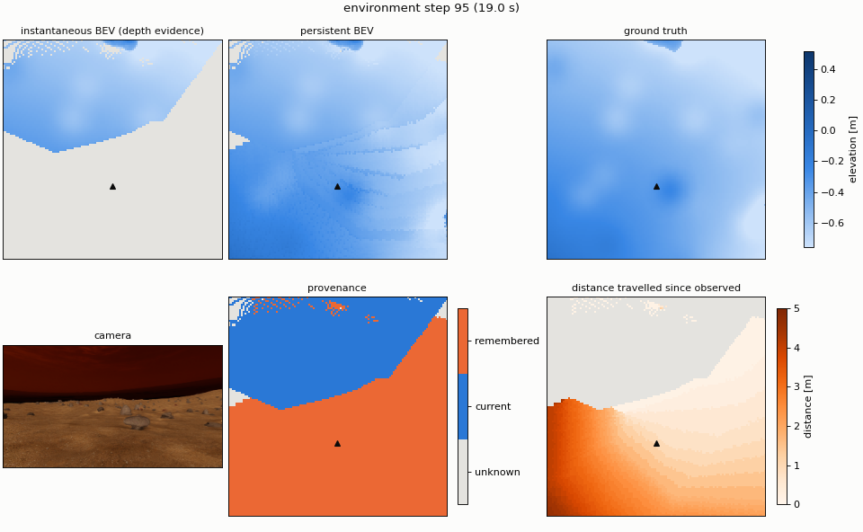

# Phase 2 — Temporal BEV memory: implementation and evaluation

Date: 27 September 2026. Plan: [`docs/plans/phase2_temporal_bev_memory.md`](../plans/phase2_temporal_bev_memory.md).
Frozen Phase-1 model: `logs/bev/rover_bev/2026-09-26_18-40-41/model_249.pt`, unchanged.

## Summary

- **The memory works.** With exact poses it covers 98.9% of the terrain the camera saw earlier but not now. Its
  elevation error there is **2.0 cm** and its rock IoU **0.82**, against 31 cm and 0.10 for the Phase-1 network's
  guesses on the same cells. The known part of the 6 × 6 m output grows from 36% (current only) to 79%.
- **Nothing degrades on the current view.** Visible cells keep their accuracy (1.58 cm, rock IoU 0.89), and the memory
  fills the current frame's far-range depth gaps: 97.9% of visible cells are covered instead of 95.1%.
- **Alignment is correct.** With exact poses, the error of remembered cells does not grow with the distance travelled
  since the cell was observed, also when driving circles that keep revisiting terrain.
- **Odometry drift is the main failure mode.** At the earlier experiments' 1× drift, cells remembered over 4–8 m of
  travel have twice the elevation error (3.6 cm) and lose rock IoU. At 4× they reach 11 cm and a rock IoU of 0.51.
- **Storing the raw depth elevation beats the network's.** It halves the memory's elevation error to 1.15 cm, in
  simulation with perfect depth.

## Stage 1 — Memory

### Conventions established by inspection

| Question | Answer in this repository |
|---|---|
| BEV cells | Layout [x, y], 120 × 120 at 5 cm; x ∈ [-2, 4) m forward, y ∈ [-3, 3) m left, in the yaw-aligned Body frame. Cell (i, j) covers [x_min + i·res, x_min + (i+1)·res) × [y_min + j·res, …) (`BevCfg`). |
| Height reference | Elevation is measured from the Body origin (the BEV frame origin), with +z up. |
| Pose of an observation | The `bev_scanner` pose (Body) in the same step. The camera is rendered after the last physics substep of that step, so there is no lag (depth-lift error 0.2 cm while driving). Exposed as the new `pose` observation group: [x, y, z, yaw] in world coordinates. |
| Observation evidence | The depth lift's point count: a cell has evidence if at least one depth pixel of the current frame lands in it. This is available on the robot. |
| Resets | A reset teleports the rover. That step's frame was rendered before the teleport, so it is neither stored nor scored, and the environment's memory is cleared. |

### Design

`BevMemory` (`rover_envs/envs/navigation/learning/bev/memory.py`, pure torch, batched over environments):

- **World-aligned wrap-around window.** 240 × 240 slots cover 12 × 12 m at 5 cm. World cell (gx, gy) =
  floor(world xy / 0.05) lives in slot (gx mod 240, gy mod 240), stored together with (gx, gy). Nothing is shifted or
  warped as the rover moves; a read checks the stored cell index, so older cells that share a slot are never returned.
- **Resampling.** Writes take the nearest ego cell of each world cell centre; reads take the world cell under each ego
  cell centre. Each observation is therefore resampled once in and once out. The position error is below about one
  cell and does not accumulate.
- **Heights.** Stored as world z (elevation + pose z) and converted back with the current pose's z.
- **Only evidence is stored.** Cells without depth points in the current frame are never written, so predictions for
  unobserved cells never enter the memory.
- **Deterministic fusion.** The latest observation replaces the previous one (`write_rule="latest"`). The alternative
  `"closest"` keeps the observation made closest to the rover.
- **Read before write.** Remembered cells therefore always come from earlier steps.
- **Output** (the persistent ego BEV, 120 × 120):
  - elevation and class probabilities, taken from the current frame where there is evidence and from memory
    elsewhere, and NaN where unknown;
  - `status` ∈ {UNKNOWN, CURRENT, REMEMBERED};
  - `age` (s) and `distance` (m travelled) since the cell was observed.

### Tests (`tests/test_bev_memory.py`, 10 tests, no simulator)

The tests cover:

- current cells passing through, and unknown cells staying unknown;
- write/read at the same pose;
- translation, which is exact;
- rotation, which is exact at 90° and within one cell of a plane at 30°;
- the height reference following the rover's z;
- age and distance;
- reset and isolation between environments;
- the closest write rule;
- a 25-step curved drive over smooth terrain with a camera-like wedge of evidence: every remembered cell stays within
  the one-cell resampling bound of the true terrain.

## Stage 2 — Evaluation

**Protocol.** `examples/03_inference/eval_bev_memory.py` runs 64 environments for 300 steps (60 s) on `mars`, seed 42,
while the height-map policy drives to its goals. The frozen Phase-1 model runs on every frame.

**Groups of cells.** These come from the ground-truth camera visibility and are used for evaluation only, through a
second memory that records where the ground truth says the camera has looked:

- **current:** visible now;
- **remembered:** visible earlier, not now;
- **unknown:** never visible.

**Methods compared:**

- the instantaneous BEV on its depth-evidence cells;
- the instantaneous BEV everywhere, i.e. the network's guess;
- the persistent BEV.

**Metrics.** Coverage is the share of a group's cells a method provides; MAE and IoU are computed over the provided
cells.

**Baseline** (exact poses, latest rule, network elevation; 19,027 frames):

| Cells (share of output) | Method | Coverage | Elevation MAE | Rock IoU |
|---|---|---|---|---|
| current (36.0%) | instantaneous, depth evidence | 95.1% | 1.56 cm | 0.894 |
| | instantaneous, everywhere | 100% | 1.60 cm | 0.894 |
| | **persistent** | **97.9%** | 1.58 cm | 0.893 |
| remembered (43.9%) | instantaneous, depth evidence | 3.2% | 6.86 cm | 0.558 |
| | instantaneous, everywhere (network guess) | 100% | 31.30 cm | 0.101 |
| | **persistent** | **98.9%** | **2.03 cm** | **0.815** |
| unknown (20.1%) | instantaneous, everywhere | 100% | 32.09 cm | 0.202 |
| | persistent | 3.0% | 5.50 cm | 0.576 |

Provenance of the persistent output cells: 35.8% current, 43.5% remembered, 20.7% unknown.



*One environment after 19 s: the camera sees the blue wedge, and the memory supplies the orange part of the map.
Faint seams in the persistent BEV are cells written at different times, from different viewing distances.*

## Stage 3 — Stress tests

The same protocol with one change each. Two driving patterns were tested: the goal-seeking policy, and 1.5 m radius
circles at 0.45 m/s, which turn continuously and revisit terrain every ~21 s. The odometry drift is the first-order
Gauss–Markov model of the earlier BEV experiments:

- forward scale bias 1.2%;
- lateral drift 0.008 m/m;
- heading drift 0.008 rad/m;
- gyro bias 0.0015 rad/s;
- vertical drift 0.008 m/m, added for the height reference;
- correlation time 4 s, plus white noise;
- all scaled by the severity.

Remembered cells, persistent BEV (the network's guess on the same cells is 29–31 cm and rock IoU 0.10–0.19):

| Run | Mean pose error | Coverage | Elevation MAE | Rock IoU |
|---|---|---|---|---|
| policy, exact (baseline) | — | 98.9% | 2.03 cm | 0.815 |
| policy, closest rule | — | 98.9% | 1.99 cm | 0.818 |
| policy, raw depth elevation | — | 98.9% | **1.15 cm** | 0.817 |
| policy, 1× drift | 8.3 cm, 1.2°, 1.9 cm z | 98.5% | 2.41 cm | 0.786 |
| policy, 4× drift | 32.5 cm, 4.6°, 7.8 cm z | 97.3% | 4.83 cm | 0.654 |
| circles, exact | — | 98.9% | 2.27 cm | 0.742 |
| circles, closest rule | — | 98.9% | 2.23 cm | 0.755 |
| circles, 1× drift | 6.2 cm, 1.3°, 1.8 cm z | 98.7% | 2.51 cm | 0.735 |
| circles, 4× drift | 24.8 cm, 5.3°, 7.2 cm z | 97.8% | 4.24 cm | 0.670 |

Elevation MAE (cm) of remembered cells against the distance travelled since they were observed:

| Run | 0–0.25 m | 0.25–0.5 m | 0.5–1 m | 1–2 m | 2–4 m | 4–8 m | ≥ 8 m |
|---|---|---|---|---|---|---|---|
| policy, exact | 2.68 | 2.11 | 1.86 | 1.71 | 1.68 | 1.87 | 1.73 |
| policy, raw depth elevation | 2.07 | 1.27 | 0.92 | 0.71 | 0.70 | 0.81 | 0.43 |
| policy, 1× drift | 2.69 | 2.15 | 1.96 | 2.02 | 2.44 | 3.58 | 3.15 |
| policy, 4× drift | 2.82 | 2.48 | 2.98 | 4.44 | 7.02 | 10.91 | 11.35 |
| circles, exact | 2.28 | 2.16 | 2.11 | 2.05 | 1.97 | 2.05 | 2.43 |
| circles, 1× drift | 2.27 | 2.18 | 2.18 | 2.24 | 2.43 | 3.14 | 4.80 |
| circles, 4× drift | 2.33 | 2.48 | 3.02 | 4.05 | 5.81 | 9.25 | 14.71 |

Rock IoU of remembered cells, same bins:

| Run | 0–0.25 m | 0.25–0.5 m | 0.5–1 m | 1–2 m | 2–4 m | 4–8 m | ≥ 8 m |
|---|---|---|---|---|---|---|---|
| policy, exact | 0.704 | 0.784 | 0.817 | 0.837 | 0.855 | 0.869 | 0.809 |
| policy, 1× drift | 0.702 | 0.779 | 0.811 | 0.815 | 0.806 | 0.773 | 0.500 |
| policy, 4× drift | 0.705 | 0.753 | 0.728 | 0.674 | 0.584 | 0.513 | 0.607 |
| circles, exact | 0.760 | 0.747 | 0.731 | 0.764 | 0.562 | 0.735 | 0.813 |
| circles, 4× drift | 0.758 | 0.732 | 0.687 | 0.668 | 0.440 | 0.280 | 0.186 |

The ≥ 8 m bin holds under 1% of the remembered cells in the policy runs.


## Where simple geometric memory fails

1. **Pose drift, which grows with the distance travelled.** At 1× (8 cm mean position error), terrain remembered over
   more than about 2 m starts to degrade, and over 4–8 m its elevation error doubles. At 4× it is useless beyond a few
   metres: 7–11 cm elevation error and rock IoU 0.3–0.6. Memory older than a few metres of travel needs a trust signal.
   The `distance` provenance is that signal, and later reliability-aware use can threshold or weight it.
2. **View boundaries.** The least accurate remembered cells are the ones that just left the view: 2.7 cm and rock IoU
   0.70 at 0–0.25 m travelled. They are mostly far-range cells in the current frame's depth gaps, and cells at
   occlusion edges around rocks, whose last observation was sparse or grazing. Terrain the rover drove past is
   remembered at close to current-view quality (1.7 cm, rock IoU 0.87).
3. **Turning.** While circling with exact poses, remembered rock IoU drops to about 0.74 against 0.82 for goal-driving.
   Rocks are then often last seen from the side at the image edge. Keeping the closest observation hardly helps
   (0.755). Fusing class evidence over several observations would be the next simple rule to try.
4. **Depth evidence is not the same as a seen top surface.** 3% of the never-visible cells still receive memory
   values, at 5.5 cm error. These are mostly depth points on rock faces that land in cells whose top was never seen.
5. **The network's elevation is less precise than its depth input.** Storing the raw lifted elevation halves the
   memory's elevation error (1.15 cm against 2.03 cm) and cuts the current view's to a third (0.48 cm against
   1.58 cm), with the same rock IoU. This holds in simulation with perfect depth; with noisy real depth the network may
   denoise and the balance could flip.
6. **Resampling is not a limiting factor.** With exact poses the error stays flat with distance, including while
   revisiting terrain, so the two nearest-cell resamplings do not accumulate.

## Caveats

- Single seed, one map (`mars`), perfect simulator depth, and one Phase-1 checkpoint. The metrics are pooled over all
  frames and cells of 64 environments × 300 steps.
- Runs with the same driving pattern are nearly but not exactly paired. Tiny physics non-determinism sometimes changes
  a trajectory: current-view MAE varies by up to 0.04 cm between otherwise identical runs, so differences of that size
  are noise.
- The ground-truth groups also go through nearest-cell resampling, so group boundaries are fuzzy by about one cell.

## Reproduce

```bash
python examples/03_inference/eval_bev_memory.py --checkpoint logs/bev/rover_bev/2026-09-26_18-40-41/model_249.pt \
    --num_envs 64 --steps 300 --terrain mars --name baseline
# Stress variants add: --write_rule closest | --elevation_source lift | --odometry_noise 1 | --odometry_noise 4
#                      --driving circle [--odometry_noise 1 | 4 | --write_rule closest]
```

Each run writes `metrics.json`, `error_vs_distance.png`, and for each environment in `--video_envs` a real-time
video `memory_env<e>.mp4` (the first `--video_steps` steps) with `memory_env<e>_snapshot.png`, to
`logs/bev_memory/<timestamp>_<name>/`. With `--wandb` the same results, plus per-step curves of how the memory builds
up, are logged to the `rlroverlab` W&B project as `bev_memory_<name>_<timestamp>`. The runs above used the earlier GIF
animation of environment 0; the console logs are in `logs/bev_memory_<name>.log`.
