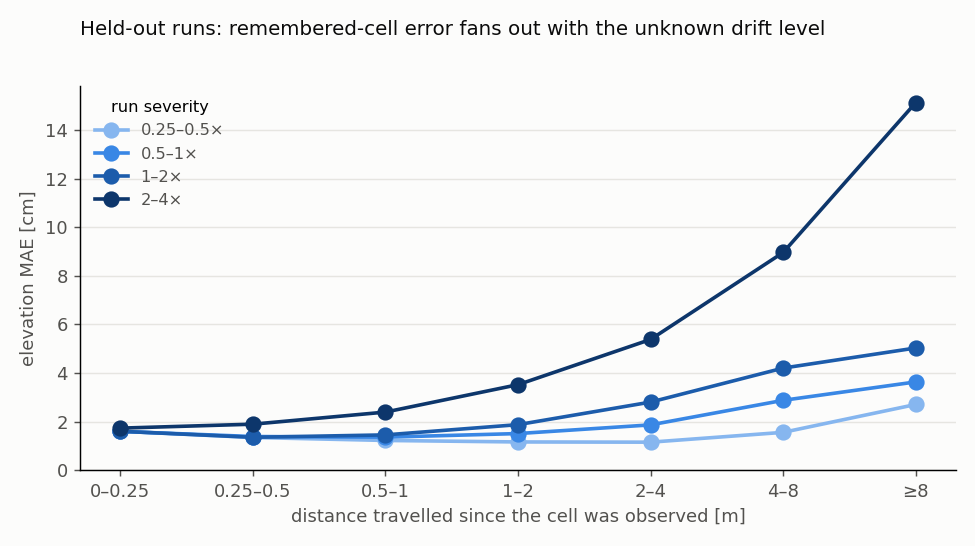
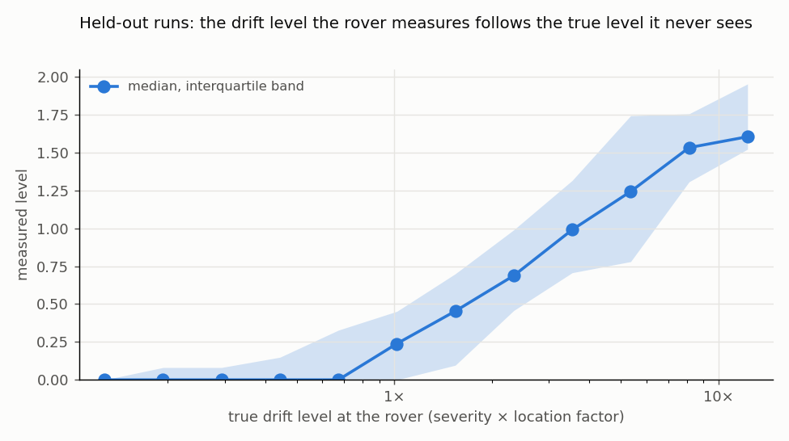
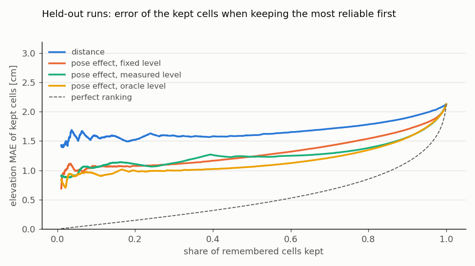

# Phase 3 — Reliability of the persistent BEV when the odometry quality is unknown

Date: 27 September 2026. Plan: [`docs/plans/phase3_reliability_unknown_odometry.md`](../plans/phase3_reliability_unknown_odometry.md).
Frozen Phase-1 models: `logs/bev/rover_bev/2026-09-26_18-40-41/model_249.pt` (clean depth) and
`logs/bev/rover_bev_noisy_depth/2026-09-26_21-32-58/model_119.pt` (noisy depth), unchanged.

## Summary

- **Phase 2 is closed.**
  - Under ZED-like noisy depth, the memory stores the raw depth-lift elevation: 1.42 cm on remembered cells, against
    1.91–1.95 cm for the network's.
  - It takes its classes from the noisy-depth model, and averages the class probabilities of all observations of a cell.
    That lifts remembered rock IoU from 0.81 to 0.87 while goal-driving, and from 0.72 to 0.83 while circling.
- **Error bars.** Over three seeds on `mars` with exact poses, remembered cells have 1.32 ± 0.09 cm elevation error and a
  rock IoU of 0.869 ± 0.011.
- **Drift whose size the rover does not know.** Each run draws its own drift level (0.25× to 4×), which also varies with
  location. The error of terrain remembered over 4–8 m ranges from 1.6 cm in the best runs to 9 cm in the worst. A
  reliability map with a fixed calibration over-predicts the error of good runs by a factor of 2.5 and under-predicts
  bad runs by up to 1.7.
- **The rover can measure its drift level itself.** It compares each cell's current observation with its first. The
  growth of their difference, normalized by what a nominal noise model predicts for the same terrain, follows the true
  level from about 1× upward (Spearman 0.72 on held-out runs). Below 1× it reads near zero, where perception errors
  dominate the map anyway.
- **With the measured level, the reliability map is calibrated in every drift octave of the held-out runs.** Observed
  over predicted error is 0.76–1.03, against 0.40–1.56 for the fixed calibration. It also ranks errors better: the AUROC
  for errors above 5 cm is 0.81, against 0.75. This meets the plan's success criterion. Knowing the true level would give
  0.95–1.07 and an AUROC of 0.83.
- **Registering frames against a keyframe cannot see the drift at 1×** with ZED-like depth on this terrain. Its floor
  of 3 cm and 0.7° per 0.5 m is above the drift it should measure; only its height correction is useful.
- **The `debug` terrain is out of distribution.** The Phase-1 classes fail there (rock IoU 0.28), and its steep slopes
  defeat a 2.5D map even with exact poses. It cannot provide error bars, and the reliability models do not transfer to it.

## 3.0 Closing Phase 2

All runs: 64 environments, 300 steps (60 s), `mars`, seed 42 unless stated. Driving is the goal-seeking height-map
policy or 1.5 m circles.

### Stored elevation under noisy depth

The task is `AAURoverEnvSimpleBEVNoisyDepth-v0`, with exact poses and the latest class. The four runs share their
trajectories. The raw lifted elevation depends only on the depth, so it gives the same numbers with both models.

| Classes from | Stored elevation | Current: MAE, rock IoU | Remembered: MAE, rock IoU |
|---|---|---|---|
| clean model (`model_249.pt`) | network | 1.44 cm, 0.796 | 1.91 cm, 0.799 |
| clean model | raw lift | 1.24 cm, 0.796 | **1.42 cm**, 0.799 |
| noisy-depth model (`model_119.pt`) | network | 1.51 cm, **0.852** | 1.95 cm, 0.809 |
| noisy-depth model | raw lift | 1.24 cm, **0.852** | **1.42 cm**, 0.808 |

**Decision** (the plan's rule): store the raw lifted elevation. Its advantage shrinks from half the error with perfect
depth to a quarter with noisy depth, but it remains. The noisy-depth model gives the better classes on noisy depth
(current rock IoU +0.056), although it trained for only 120 iterations. From here on, every run uses noisy depth, the
noisy-depth model and the raw lift.

### Class evidence fusion

Remembered rock IoU, exact poses:

| Driving | latest | mean | log-odds (clamped at 2%) |
|---|---|---|---|
| goal-driving | 0.808 | **0.869** | 0.854 |
| … cells that just left the view (0–0.25 m) | 0.709 | **0.818** | 0.773 |
| 1.5 m circles | 0.720 | **0.833** | 0.799 |

The running mean of the class probabilities meets the plan's criterion: rock IoU ≥ 0.80 while circling, without losing
any while goal-driving. It is the new default. It fixes the Phase-2 failure in which the last, often grazing observation
of a rock decided its class. Elevation is unaffected.

Under drift, averaging combines observations placed at drifting poses, which can blur rocks. The comparison below uses
the same seed and trajectories for both rules:

| Drift | Rule | Remembered rock IoU | … by severity octave (0.25–0.5×, 0.5–1×, 1–2×, 2–4×) |
|---|---|---|---|
| varying, 0.25× to 4× (3.1) | latest | 0.756 | 0.806 · 0.804 · 0.722 · 0.664 |
| | mean | **0.782** | **0.854 · 0.844 · 0.752** · 0.640 |
| fixed 4× | latest | **0.644** | |
| | mean | 0.628 | |
| | mean over the last 10 observations | 0.632 | |

The mean wins up to 2×. In the worst octave it costs about 0.02, mostly on cells remembered over more than a metre. A
fusion that weights observations by the measured drift level could keep the best of both; it is not needed now.

### Error bars

Settled configuration with exact poses; mean ± half the range over seeds:

| Runs | Current: MAE, rock IoU | Remembered: MAE, rock IoU | Remembered over 4–8 m |
|---|---|---|---|
| goal-driving, seeds 42, 43, 44 | 1.22 ± 0.02 cm, 0.852 ± 0.015 | 1.32 ± 0.09 cm, 0.869 ± 0.011 | 1.36 ± 0.03 cm |
| circles, seeds 42, 43 | 1.29 ± 0.02 cm, 0.855 ± 0.004 | 1.62 ± 0.04 cm, 0.841 ± 0.008 | 1.09 ± 0.04 cm |

Differences smaller than about 0.1 cm in remembered elevation MAE, or 0.02 in rock IoU, are within seed-to-seed
spread. With the Phase-2 fixed drift and this configuration (seed 42, goal-driving), remembered cells have 1.84 cm and
rock IoU 0.825 at 1× (mean pose error 8.5 cm, 1.2°), and 4.52 cm and 0.628 at 4× (35 cm, 4.9°). Over 4–8 m of
travel, that is 3.4 cm at 1× and 11.3 cm at 4×, as in Phase 2.

### The `debug` terrain is not a second test terrain yet

With exact poses on `debug`, the memory's remembered cells have 6.6 cm error and rock IoU 0.26, and 23% of the cells
the camera never saw receive values (4% on `mars`). The error does not grow with the distance travelled, so the memory
stays aligned; the observations themselves are wrong:

- **Appearance.** The Phase-1 classes fail on `debug`'s look: current rock IoU 0.28.
- **Steep ground.** The terrain is much steeper than `mars`. Depth cells without a clear top-down counterpart get
  8.5 cm error, against 1.5 cm on `mars`.
- **Self-observation.** On steep ground the tilted camera sees the rover itself. 1.0% of the current depth evidence
  lies inside the rover's footprint (0.004% on `mars`), with a 49 cm error, 6% of the total.

Error bars on a second terrain therefore need a terrain that resembles the training data, or broader Phase-1 training.
A mask of the rover's footprint on the depth evidence is a cheap fix for the third point.

## 3.1 Drift of unknown and varying size

`OdometryDrift` (`learning/bev/odometry.py`) keeps the Phase-2 error structure; a fixed severity reproduces the Phase-2
drift, which a unit test checks against the original. It adds two sources of variation that the memory is never told
about:

- **Per run.** Every episode draws its own severity log-uniformly from 0.25× to 4×. The initial draw is stratified, so
  the 64 environments cover the four octaves evenly.
- **By location.** A smooth random field over the world, shared by all environments like a property of the terrain,
  multiplies the level by exp(0.5 g), with g of unit variance and a 5 m correlation length. Biases stay continuous
  where the level changes.

The Phase-3 dataset runs use this protocol (`--odometry_noise 0.25:4 --drift_field_std 0.5`). Seed 42 (goal-driving
and circles) is for fitting, seeds 43 and 44 are held out. Held-out runs, pooled by the runs' severity octave:

| Run severity | Mean pose error | Remembered MAE | … remembered over ≥ 1 m |
|---|---|---|---|
| 0.25–0.5× | 3.3 cm, 0.55° | 1.40 cm | 1.22 cm |
| 0.5–1× | 6.0 cm, 0.91° | 1.78 cm | 1.84 cm |
| 1–2× | 12.6 cm, 1.98° | 2.17 cm | 2.46 cm |
| 2–4× | 27.1 cm, 4.49° | 3.85 cm | 4.99 cm |



## 3.2 Reliability from observable signals, with a fixed calibration

Each model maps a signal the rover has to the expected elevation error of a remembered cell, through a monotone
(isotonic) map fitted on the training runs. It is scored on 1.8 million remembered cells of the held-out runs
(`examples/03_inference/analyze_bev_reliability.py`). The signals are:

- **distance:** the distance travelled since the cell was observed, the Phase-2 provenance.
- **U_pose:** the cell's pose uncertainty under a nominal random-walk model. Heading errors displace a cell in proportion
  to its distance from the path, so the model integrates the lever arm, ∫ |c − p|² ds, along the actual path since the
  observation. Only running path moments are needed.
- **pose effect:** what that uncertainty does to the elevation, given the local slope. The slope is the largest
  difference to a neighbouring cell in the persistent map, per 5 cm. The effect is slope² × horizontal variance / 2 plus
  the height variance.

| Model | Spearman | AURC | AUROC, errors > 5 cm | Observed / predicted by severity, remembered ≥ 1 m |
|---|---|---|---|---|
| distance | 0.252 | 1.67 cm | 0.657 | 0.42 · 0.62 · 0.87 · 1.70 |
| U_pose | 0.275 | 1.60 cm | 0.668 | 0.42 · 0.63 · 0.86 · 1.70 |
| pose effect, fixed level | 0.363 | 1.30 cm | 0.748 | 0.40 · 0.60 · 0.83 · 1.56 |

AURC is the area under the risk–coverage curve: the mean error of the kept cells, averaged over all coverages when the
most reliable cells are kept first. A perfect ranking scores 0.52 cm here.

- **The plan's U_pose decision:** keep it, in its terrain-aware form. U_pose alone ranks only slightly better than the
  distance. Combined with the slope, it cuts the AURC by a fifth and raises the AUROC from 0.66 to 0.75.
- **As expected, no fixed calibration fits all runs.** Each model over-predicts the error of good runs by a factor of 2.5
  and under-predicts bad runs by up to 1.7. Nothing observable in this step reveals the run's drift level.
- **A Gaussian error model fails.** With the pose effect as the variance of a Gaussian, even the true level left the
  calibration at 0.62–2.02. Rock edges make the linear slope model over-predict, and the fit shrinks the pose term to
  compensate. The monotone map does not have this problem.

## 3.3 Measuring the drift online

### Keyframe registration: too noisy at 1×

`KeyframeRegistration` (`learning/bev/registration.py`) registers each frame's depth lift against a keyframe 0.5 m back
along the route. It searches a coarse-to-fine grid over (x, y, yaw), takes the height offset as the median residual,
and scores hypotheses on a common set of cells, so that none wins by gaining overlap. On recorded frames with exact
poses, its noise floor per registration is:

| Heights used | Keyframe | x | y | yaw | z |
|---|---|---|---|---|---|
| ground truth, on the observed cells | 1 m | 1.6 cm | 2.5 cm | 0.69° | 0.04 cm |
| raw noisy-depth lift | 1 m | 8.2 cm | 8.6 cm | 2.15° | 1.67 cm |
| raw noisy-depth lift, narrower search | 0.5 m | 3.0 cm | 3.1 cm | 0.70° | 0.61 cm |

The drift over 0.5 m is about 0.75 cm and 0.28° at 1×, and four times that at 4×. On the held-out runs, the measured
corrections correlate with the true ones at 0.50 (x), 0.33 (y), 0.60 (yaw) and 0.85 (z). Even perfect heights leave a
horizontal floor near the 1× drift on this smooth terrain. The registration therefore cannot correct the pose, and it
is not used below.

### Revisit monitor: the rover's own drift level

`BevMemory` now also keeps the first observation of every world cell, and `DriftMonitor` (`learning/bev/drift.py`)
compares each current observation with it:

- **Principle.** Without drift, the difference is perception noise, however far the rover has driven in between. With
  drift, it grows with that distance.
- **Floor.** The perception noise floor is measured the same way, on cells first seen only 0–0.25 m of travel ago.
- **Excess.** The excess over the floor, of cells first seen 1–3 m ago, is the drift's contribution.
- **Level.** The excess is divided by the excess the nominal noise model predicts at 1× for the same cells, given their
  slope, distance and range. The result is a drift level that does not depend on how rocky the ground is.
- **Robustness.** Differences are truncated at 10 cm, so rare view changes at rock edges do not dominate. The sums
  forget over 5 m of travel, so the level follows the ground the rover is on.

No ground truth and no noise level enter, only the nominal model's shape. Replaying recorded frames with synthetic drift
shows that the measured level is proportional to the true one from 1× upward:

| True severity | 0 | 0.25× | 0.5× | 1× | 2× | 4× |
|---|---|---|---|---|---|---|
| measured level: median (interquartile range) | 0.00 (0–0.18) | 0.00 (0–0.20) | 0.00 (0–0.26) | 0.28 (0–0.46) | 0.63 (0.42–0.85) | 1.18 (0.88–1.50) |

The absolute scale is about a third of the truth. The random-walk nominal model overstates the effect over 1–3 m,
where the correlated biases grow quadratically rather than linearly. The monotone calibration absorbs the constant
factor. On the held-out runs, the measured level has a Spearman correlation of 0.72 with the true local level.



## 3.4 Adaptive reliability

The pose effect is now scaled by the square of the measured level, averaged over the path since each cell was observed:
a bad stretch only raises the uncertainty of cells observed before it. Where the monitor has no estimate yet, for
example right after a reset, the training runs' median stands in. Held-out runs, as in 3.2:

| Model | Spearman | AURC | AUROC, errors > 5 cm | Observed / predicted by severity, remembered ≥ 1 m |
|---|---|---|---|---|
| pose effect, fixed level | 0.363 | 1.30 cm | 0.748 | 0.40 · 0.60 · 0.83 · 1.56 |
| **pose effect, measured level** | **0.431** | **1.27 cm** | **0.810** | **0.76 · 0.93 · 0.89 · 1.03** |
| … with the level at read time only | 0.437 | 1.29 cm | 0.809 | 0.77 · 0.94 · 0.89 · 1.01 |
| pose effect, true level (oracle) | 0.488 | 1.17 cm | 0.832 | 0.95 · 1.06 · 0.95 · 1.07 |
| true displacement (oracle) | 0.536 | 1.17 cm | 0.837 | 0.83 · 0.92 · 0.85 · 0.98 |

- **The plan's criterion is met.** The measured level keeps observed over predicted error within 0.67–1.5 in every
  severity octave, where the fixed calibration falls outside, and its AURC is no worse (1.27 against 1.30 cm).
- **Per held-out run,** it improves the AURC and the AUROC over the fixed model in all three runs. It stays within the
  band in 11 of 12 run-octaves; the lowest octave of seed 43 goal-driving is at 0.66.
- **Remaining gap to the oracle.** Below 1× the monitor reads near zero, so the lowest octave is still over-predicted
  (0.76). The gap to the oracle's ranking is the monitor's noise.
- **Path average or read time.** Averaging over the path since observation and using the level at read time perform
  alike on these runs.




**Rock classes (3.6, free signals).** The entropy of a remembered cell's averaged class probabilities detects wrong
classes with an AUROC of 0.98 on `mars` (0.86 on `debug`). The local slope reaches 0.87, and the distance since
observation 0.56. Class reliability therefore needs no new head.

**Transfer to `debug`.** Models fitted on `mars` do not transfer. On `debug` the remembered error is 8–14 cm whatever
the drift, dominated by the perception failures above, so all models under-predict it by a factor of 1.8 to 5. The monitor reads
0.5–0.75 even in low-drift runs there. It correctly detects that the map is inconsistent, but it attributes the
inconsistency to drift.

## Decisions and next steps

1. **Measure, do not correct (plan 3.5).** Registration cannot measure horizontal drift at 1× on this terrain, so it
   cannot correct the pose either. The revisit monitor measures the level but not the direction of the error. Pose
   correction would need a stronger geometric signal, e.g. a map fused from several frames. It is not recommended now.
2. **Reliability channels for Phase 4:**
   - the expected elevation error from the pose effect at the measured level;
   - the class entropy;
   - the provenance.

   The memory must then compute U_pose online. The running path moments since each cell's observation cost three
   numbers per cell.
3. **Perception reliability.** The `debug` result shows that pose-based reliability cannot catch perception failures on
   unfamiliar terrain. Before Phase 4 runs on more than `mars`, the plan's step 3.6 needs an elevation-uncertainty
   signal: the disagreement between the network and the raw lift, or the log σ head. Phase 1 also needs training on more
   terrains.
4. **Small fixes:**
   - mask the rover's footprint from the depth evidence;
   - use a second, `mars`-like test terrain for error bars;
   - the Phase-1 noisy-depth model trained for 120 iterations only; a longer run would likely improve the classes.

## Reproduce

Runs write to `logs/bev_memory/<timestamp>_<name>/`; console logs are in `logs/bev_memory_<name>.log`.

```bash
MODEL=logs/bev/rover_bev_noisy_depth/2026-09-26_21-32-58/model_119.pt
BASE="--task AAURoverEnvSimpleBEVNoisyDepth-v0 --checkpoint $MODEL --elevation_source lift --class_fusion mean \
      --num_envs 64 --steps 300 --terrain mars"
# 3.0: vary --elevation_source, --class_fusion, --driving circle, --seed and --terrain as in the tables.
python examples/03_inference/eval_bev_memory.py $BASE --seed 42 --name p3_policy_mean
# 3.1-3.4: drift of unknown, varying size, with cell samples and keyframe registrations.
DRIFT="--odometry_noise 0.25:4 --drift_field_std 0.5 --drift_field_length 5 --dump_samples 32 --keyframe_distance 0.5"
python examples/03_inference/eval_bev_memory.py $BASE $DRIFT --seed 42 --name p3_data2_policy_s42  # also --driving circle
python examples/03_inference/eval_bev_memory.py $BASE $DRIFT --seed 43 --name p3_data2_policy_s43  # also circle, seed 44
python examples/03_inference/analyze_bev_reliability.py \
    --train logs/bev_memory/<...>_p3_data2_policy_s42 logs/bev_memory/<...>_p3_data2_circle_s42 \
    --test logs/bev_memory/<...>_p3_data2_policy_s43 logs/bev_memory/<...>_p3_data2_circle_s43 \
           logs/bev_memory/<...>_p3_data2_policy_s44
```

`--save_frames 8` records the depth lift of eight environments, on which the registration and the monitor were
developed offline with synthetic drift. The analysis writes `reliability.json` and the four figures to
`logs/bev_reliability/`.
