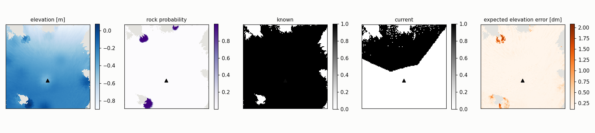
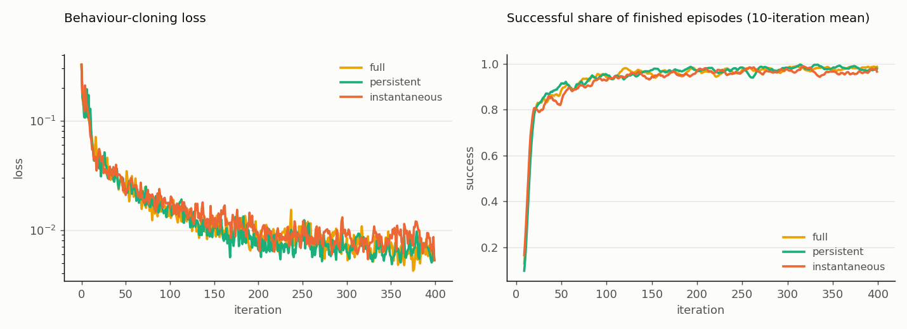

# Phase 4 — Driving on the persistent BEV: distillation

Date: 27–28 September 2026. Plan: [`docs/plans/phase4_bev_distillation.md`](../plans/phase4_bev_distillation.md).

## Summary

- **The BEV student drives as well as the teacher.**
  - Distilled from the height-map PPO teacher in 400 iterations, a student that sees only its own persistent BEV and
    the goal succeeds in 97.3% of held-out episodes.
  - This holds under odometry drift drawn per episode from 0.25× to 4×, which it never sees.
  - The teacher, which sees exact terrain, succeeds in 97.9%, and the image-only RGB student in 97.4%.
- **With a working camera, the current view is enough on this task.** All students tie with the teacher, including
  the one without memory, so the plain comparison cannot show what memory, provenance or reliability are worth.
- **Memory keeps the rover driving when the camera drops out.** Blind for 2 s of every 5 s, the students with a
  persistent BEV keep 97% success, while the image-only and instantaneous-BEV students fall to 88–90%. Blind for 4 s
  of every 5 s, the memory students collide in 4.5–5.5% of their episodes, and the current-view students in 24–28%.
- **Provenance and reliability do not change driving here.** The full student, which also sees which cells are
  current and how wrong each is expected to be, is indistinguishable from the persistent one in every condition:
  - without dropouts and with dropouts;
  - by drift octave;
  - under a severe 4–16× drift probe.

  Drift up to 4× displaces remembered terrain by centimetres, small next to 20–50 cm rocks.
- **Distillation cannot teach the student to act on its own uncertainty.** The teacher sees exact terrain, so its
  actions are the same whatever the student's map quality. Behaviour cloning therefore gives no reason to drive
  differently on unreliable cells. Testing the reliability channel needs PPO fine-tuning with a wider drift range, and
  a task where memory errors matter.

## Setup

- **Tasks.** `AAURoverEnvSimpleBEVDistillation-v0` (full variant) and its ablations `…Persistent-v0` and
  `…Instantaneous-v0`: the BEV noisy-depth task plus the student's goal observations. `PersistentBevVecEnv` adds the
  `bev` group; the runner stores only `policy` (teacher), `proprio` and `bev`.
- **Perception.** The settled Phase-3 configuration:
  - noisy depth and the slim noisy-depth Phase-1 model (`policies/bev_perception_noisy_depth.pt`);
  - the raw lift stored, with class probabilities averaged;
  - the drift monitor and the online reliability map (`policies/bev_reliability_map.npz`).

  Drift is drawn per episode from 0.25× to 4× and varies with location. The policy never sees it.
- **Variants.**
  - Full: elevation, rock probability, known, current and expected error.
  - Persistent: elevation, rock probability and known.
  - Instantaneous: the current frame's elevation, rock probability and an observed mask, without memory.

  Their observations at 15 s into an episode:

  
- **Student.**
  - A CNN over the BEV: 32, 64, 64 and 64 channels at stride 2, then 256 features.
  - Joined with the goal observations, then a GRU of 2 × 256 and an MLP of 512, 256 and 128 with tanh output.
  - Trained by RSL-RL distillation from the height-map PPO teacher: 64 environments, 60 steps per iteration,
    400 iterations of about 15 s each, `mars`, seed 42. All three variants trained alike:

  
- **Evaluation** (`examples/03_inference/eval_bev_policy.py`).
  - Held-out seed 43, 64 environments, 1500 steps (300 s); only finished episodes count, 900–1200 of them per run.
  - Outcomes: success, collision, leaving the area, time limit. For successes, also the path length over the
    straight-line distance, and the time.
  - Camera dropouts blind the camera in periodic windows with a random phase per environment. BEV students then get no
    new evidence, and the RGB student black frames; the odometry keeps running. The teacher does not use the camera.

## Results

Success rate with its Wilson 95% interval, and collision rate. The BEV students run with drift from 0.25× to 4×:

| Policy | Camera working | Blind 2 s of every 5 s | Blind 4 s of every 5 s |
|---|---|---|---|
| height-map teacher | 0.979 (0.968–0.986), 0.018 | not affected | not affected |
| RGB student | 0.974 (0.961–0.982), 0.025 | 0.904 (0.883–0.921), 0.096 | 0.756 (0.729–0.781), 0.244 |
| BEV, instantaneous | 0.979 (0.967–0.986), 0.017 | 0.880 (0.859–0.899), 0.118 | 0.723 (0.697–0.748), 0.277 |
| BEV, persistent | 0.982 (0.972–0.989), 0.014 | 0.966 (0.952–0.975), 0.030 | 0.948 (0.932–0.961), 0.045 |
| BEV, full | 0.973 (0.961–0.982), 0.025 | 0.975 (0.963–0.983), 0.023 | 0.942 (0.925–0.955), 0.055 |


- **Other outcomes.** No policy left the area. Time limits ended at most 0.6% of the episodes. Successful paths were
  4–6% longer than the straight line, and took 18–20 s.
- **Exact poses.** With the drift switched off, the full student succeeds in 0.978 of its episodes, the same as with
  drift.

BEV students by the episode's drift octave, success rate (each cell holds 205–312 episodes, so intervals are about
±2–4 points):

| Student | Camera | 0.25–0.5× | 0.5–1× | 1–2× | 2–4× |
|---|---|---|---|---|---|
| instantaneous | working | 0.992 | 0.972 | 0.970 | 0.980 |
| | blind 2 s of 5 s | 0.900 | 0.877 | 0.897 | 0.845 |
| | blind 4 s of 5 s | 0.738 | 0.685 | 0.734 | 0.732 |
| persistent | working | 0.987 | 0.972 | 0.982 | 0.987 |
| | blind 2 s of 5 s | 0.973 | 0.957 | 0.951 | 0.980 |
| | blind 4 s of 5 s | 0.944 | 0.934 | 0.955 | 0.959 |
| full | working | 0.996 | 0.973 | 0.957 | 0.965 |
| | blind 2 s of 5 s | 0.982 | 0.972 | 0.983 | 0.963 |
| | blind 4 s of 5 s | 0.914 | 0.929 | 0.980 | 0.946 |

**Severe drift probe.** This used drift from 4× to 16×, beyond the training range, with the camera blind 4 s of every
5 s:

- full student: 0.909 success, 0.088 collision (972 episodes);
- persistent student: 0.921 success, 0.074 collision (942 episodes).

Both lose about three points against the 0.25–4× range, and the full student does not degrade less.

## What this means

1. **The plan's first criterion is met with room to spare.** The full student reaches 98% of the teacher's success
   rate up to 2× drift.
2. **Its second criterion is not met.** The full student does not lose less with drift than the persistent one,
   because neither loses anything consistent. The drift octaves differ by a few points, at most seven, without a
   consistent trend and mostly within the intervals.
3. **Memory is the component that matters for driving.** Against the instantaneous BEV, which has the same inputs
   without memory, it is worth about 9 points of success with the camera blind 40% of the time. With it blind 80% of
   the time, it is worth about 22 points.
4. **Why the reliability channel is unused.** With exact-terrain labels from the teacher, the student learns what the
   teacher would do, never how to hedge against its own map. On this terrain, even 16× drift moves remembered rocks by
   less than their size over a dropout, so a hedging policy would also gain little.

## Next steps

- **PPO fine-tuning** of the full and persistent students, starting from these checkpoints (next steps, Step 3.3).
  - Drift should range up to 16×, and camera dropouts should occur in training, so that remembered terrain is often
    and substantially wrong.
  - The reward already penalizes collisions. A policy that can see the expected error may learn to slow down or keep
    clear where the map is unreliable, which distillation cannot teach.
- **A task where memory errors matter,** before more ablations:
  - denser or smaller obstacles, or narrow passages;
  - goals behind the rover, which force turns through remembered terrain;
  - longer dropouts;
  - the `debug` terrain, once Phase 1 generalizes to it.
- **Camera dropouts in training,** also for the distillation baseline. All students here were trained with a working
  camera, and dropouts appeared only at evaluation.

## Reproduce

```bash
# Training (distillation from the task's height-map teacher); the ablations use ...Persistent-v0 and
# ...Instantaneous-v0.
python examples/02_training/train_rsl_rl.py --task AAURoverEnvSimpleBEVDistillation-v0 --num_envs 64 --terrain mars
# Evaluation on held-out seed 43; --policy teacher | rgb | bev, and --variant for BEV students.
python examples/03_inference/eval_bev_policy.py --policy bev --variant full \
    --checkpoint logs/rsl_rl/rover_bev_distillation/<run>/model_399.pt
# Camera dropouts: add --blind_steps 10 (2 s of every 5 s) or 20 (4 s); severe drift: --severity 4:16.
python examples/03_inference/compare_bev_policies.py --runs "teacher@working=<run>" "full@working=<run>" \
    "full@blind 40%=<run>" ... --training "full=logs/rsl_rl/rover_bev_distillation/<run>" ...
```

The checkpoints used here are `logs/rsl_rl/rover_bev_distillation/2026-09-27_19-45-33/model_399.pt`, with the two
ablations in `rover_bev_distillation_persistent/` and `rover_bev_distillation_instantaneous/`. The evaluation runs are
the `p4_*` folders in `logs/bev_policy/`. The RGB student is the task's included `best_agent_rsl_rl_rgb.pt`.
