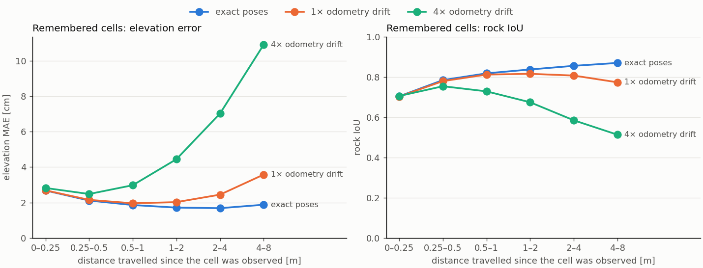
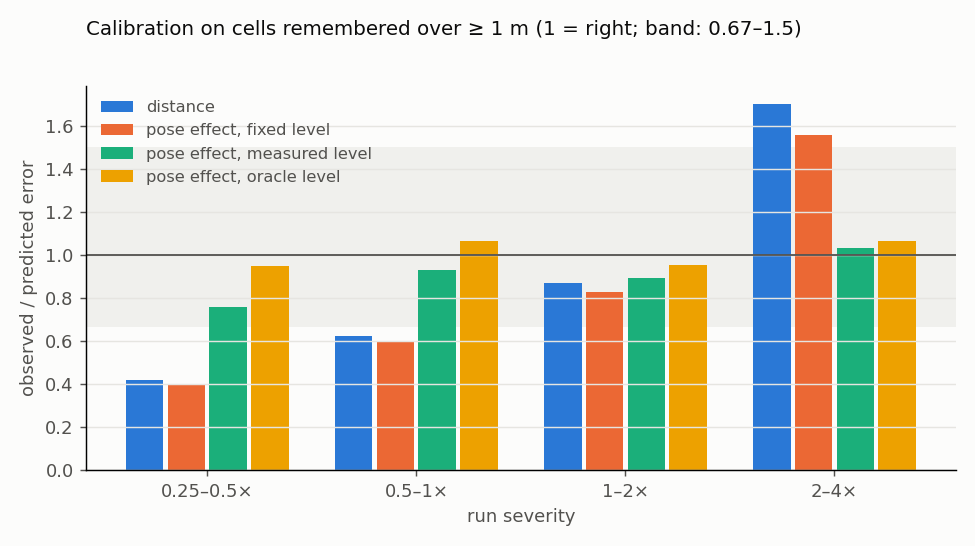
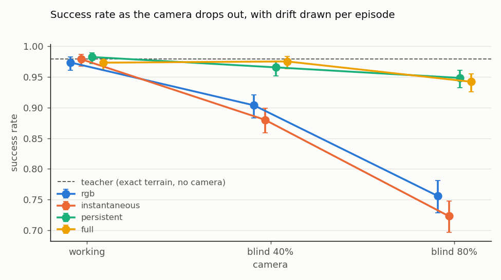

# BEV perception — results summary

Status on 27 September 2026. Detailed write-ups:

- [Phase 1 input ablations](phase1_input_ablations.md)
- [Phase 2 temporal memory](phase2_temporal_memory.md)
- [Phase 3 reliability under unknown odometry quality](phase3_reliability.md)
- [Phase 4 driving on the persistent BEV: distillation](phase4_distillation.md)

W&B project: https://wandb.ai/aalborg-university/RLRoverLab

## Phase 1 — instantaneous BEV

**Model.** One ZED2i WVGA RGB-D frame goes through a frozen DINOv3 ViT-S/16, whose features are lifted into a 120 × 120
BEV (5 cm cells, x ∈ [-2, 4] m, y ∈ [-3, 3] m) by the depth image. Per-cell geometry is added (mean elevation, elevation
range, point count). A small U-Net then predicts two outputs: the elevation and a ground/rock class. 4.9 M parameters
are trained; the targets come from downward ray casts, and the losses only use cells the camera sees.

**Longest run** (`logs/bev/rover_bev/2026-09-26_18-40-41`, 294 iterations; its `model_249.pt` is the frozen model used
in Phase 2). Over its last 40 iterations it reached **1.16 cm elevation MAE** and **rock IoU 0.895** on visible cells.

**Input ablations** (120 iterations, 64 environments, median of the last 40 iterations):

| Input | Elevation MAE | Rock IoU |
|---|---|---|
| Geometry + DINOv3 (kept) | 1.53 cm | 0.882 |
| Geometry only | 1.58 cm | 0.872 |
| DINOv3 only | 7.67 cm | 0.825 |
| Geometry + DINOv3, noisy stereo depth | 1.55 cm | 0.853 |

Perfect depth solves nearly all of the elevation. DINOv3 adds a small but consistent gain on rocks (+0.010 IoU in every
paired iteration). Appearance alone cannot give metric height.

## Phase 2 — temporal memory

**Memory.** A world-aligned memory stores the frozen model's elevation and class probabilities in 5 cm world cells,
12 × 12 m around each rover. It writes only cells that received depth points in the current frame, and the latest
observation replaces the previous one. Reading it back gives a persistent 120 × 120 BEV with each cell's provenance
(current, remembered or unknown) and the time and distance since the cell was observed.

**Evaluation.** 64 environments drove for 60 s on `mars`. The runs below are the ones on W&B; all use the model's
output. Ground truth is used only to score the maps and to group the cells.

| Run | W&B | Map known* | Remembered: coverage | Remembered: elevation MAE | Remembered: rock IoU |
|---|---|---|---|---|---|
| Goal-driving, exact poses | [lny37b6c](https://wandb.ai/aalborg-university/RLRoverLab/runs/lny37b6c) | 80% | 99.0% | 2.00 cm | 0.816 |
| … storing raw depth elevation | [76z9pt9w](https://wandb.ai/aalborg-university/RLRoverLab/runs/76z9pt9w) | 79% | 98.9% | **1.11 cm** | 0.815 |
| … 1× odometry drift (8 cm, 1.2° mean error) | [3wuz4q47](https://wandb.ai/aalborg-university/RLRoverLab/runs/3wuz4q47) | 79% | 98.5% | 2.41 cm | 0.786 |
| … 4× odometry drift (34 cm, 4.6°) | [iwmqew70](https://wandb.ai/aalborg-university/RLRoverLab/runs/iwmqew70) | 80% | 97.3% | 4.76 cm | 0.649 |
| 1.5 m circles, exact poses | [lpd7mjtc](https://wandb.ai/aalborg-university/RLRoverLab/runs/lpd7mjtc) | 75% | 98.9% | 2.27 cm | 0.742 |
| … 4× odometry drift (25 cm, 5.3°) | [by64m4ep](https://wandb.ai/aalborg-university/RLRoverLab/runs/by64m4ep) | 75% | 97.8% | 4.24 cm | 0.669 |

\* The share of the 6 × 6 m map that is current or remembered; the current view alone covers 36%.

"Remembered" means terrain the camera saw earlier but not now. On those cells the network's own guess scores 29–31 cm
and rock IoU 0.10–0.19. On the currently visible cells nothing degrades: 1.58 cm and rock IoU 0.89 with or without
memory. The memory also fills the current frame's far-range depth gaps, raising coverage from 95% to 98% of visible
cells.

Elevation MAE of remembered cells by distance travelled since they were observed (goal-driving):

| Poses | 0–0.25 m | 0.25–0.5 m | 0.5–1 m | 1–2 m | 2–4 m | 4–8 m |
|---|---|---|---|---|---|---|
| Exact | 2.78 cm | 2.06 cm | 1.77 cm | 1.64 cm | 1.60 cm | 1.70 cm |
| 1× drift | 2.68 cm | 2.14 cm | 1.95 cm | 2.02 cm | 2.44 cm | 3.57 cm |
| 4× drift | 2.89 cm | 2.48 cm | 2.93 cm | 4.37 cm | 6.91 cm | 11.44 cm |

### Findings

1. **The memory is aligned.** With exact poses the error does not grow with the distance travelled, also while
   revisiting terrain.
2. **Odometry drift is the main failure mode.** Remembered terrain degrades with the distance travelled since it was
   seen. The recorded distance per cell is the natural trust signal for later use.
3. **Storing the raw depth elevation halves the memory's elevation error** compared with the network's elevation. This
   holds with perfect simulator depth and may change with real, noisy depth.
4. **Remembered rocks are hardest right after they leave the view** (IoU 0.70) and while turning (about 0.74). Terrain
   the rover drove past keeps rock IoU around 0.87. Keeping the closest observation instead of the latest does not help.

## Where to see what on W&B

- **Memory runs** (the six links above): each has `media/video_env0`–`video_env3` and `media/snapshot_env*`, with
  nine panels in three rows:
  - elevation: instantaneous (cells with depth), persistent and ground truth;
  - class (ground or rock): instantaneous, persistent and ground truth;
  - camera, provenance (current, remembered or unknown), and distance travelled since the cell was observed.

  They also have `step/*` curves of how the memory builds up, and `error_vs_distance`. The run summary holds all
  metrics, e.g. `remembered/persistent/rock_iou`.
- **Superseded runs.** An earlier batch of the same six runs (etug4kr4, 8jlie8pe, s6jzu4yj, mj09gl1w, liq75bqn,
  tq2jg1fy) has videos without the class row and can be deleted.
- **Phase-1 training runs** show the class maps under `BEV/visualization`, next to the elevation panels. Examples:
  - the long run, [icevgf4f](https://wandb.ai/aalborg-university/RLRoverLab/runs/icevgf4f);
  - the 120-iteration run, [nuxo4xd0](https://wandb.ai/aalborg-university/RLRoverLab/runs/nuxo4xd0).

## Idealizations and caveats

- **Perfect sensing:** simulator depth is noise-free, and the memory runs without drift use the exact simulator pose.
- **Limited scope:** one map (`mars`), one seed, and one Phase-1 checkpoint.
- **Noise level:** differences of a few tenths of a centimetre between runs are within run-to-run noise.

## Phase 3 — reliability when the odometry quality is unknown

Details: [Phase 3 results](phase3_reliability.md), plan: [Phase 3 plan](../plans/phase3_reliability_unknown_odometry.md).
These runs are not on W&B; everything is in `logs/bev_memory/` and `logs/bev_reliability/`.

**Settled memory configuration.**

- Depth is ZED-like noisy depth.
- The memory stores the raw lifted elevation: 1.42 cm on remembered cells, against 1.91 cm for the network's.
- Classes come from the noisy-depth model, with the class probabilities averaged over all observations of a cell.
  Remembered rock IoU is 0.87 while goal-driving and 0.83 while circling, up from 0.81 and 0.72.
- With exact poses over three seeds, remembered cells have 1.32 ± 0.09 cm error and a rock IoU of 0.869 ± 0.011.

**Drift of unknown size.** Each run draws its own drift level (0.25× to 4×), which also varies with location, and the
memory is never told it. The rover measures the level itself: it compares its current view of terrain with its first
view of the same terrain (`DriftMonitor`). Reliability models map a signal to the expected error of each remembered cell,
fitted on seed 42 and scored on 1.8 million remembered cells of seeds 43 and 44:

| Reliability model | AUROC, errors > 5 cm | Observed / predicted error by severity octave, remembered ≥ 1 m |
|---|---|---|
| distance since observation (Phase 2) | 0.66 | 0.42 · 0.62 · 0.87 · 1.70 |
| pose effect, fixed drift level | 0.75 | 0.40 · 0.60 · 0.83 · 1.56 |
| pose effect, the rover's measured level | 0.81 | 0.76 · 0.93 · 0.89 · 1.03 |
| … plus the network–lift disagreement (3.6) | **0.84** | **0.76 · 0.91 · 0.93 · 1.08** |
| pose effect, the true level (oracle) | 0.83 | 0.95 · 1.06 · 0.95 · 1.07 |

The pose effect is the nominal pose uncertainty of a cell, including the lever arm of heading errors, times the local
slope. It ranks errors better than the distance. With the level the rover measures itself, it is calibrated in every
drift octave, which meets the plan's criterion.

The disagreement between the network's elevation and the raw depth lift is a free perception signal. It lifts the
ranking beyond the true-level model, and on the unfamiliar `debug` terrain it almost halves the risk–coverage area
(10.7 → 5.9 cm). This full map, in a form that needs no path history, is the reliability channel of the Phase-4
policy.

Two negative results:

- **Keyframe registration.** Registering frames against a keyframe cannot see horizontal drift at 1× with ZED-like
  depth: its floor is 3 cm and 0.7° per 0.5 m.
- **The `debug` terrain.** It is out of distribution for the Phase-1 model, and none of the reliability models transfer
  to it.

The class entropy flags wrong rock classes with an AUROC of 0.98.

## Phase 4 — driving on the persistent BEV

Details: [Phase 4 results](phase4_distillation.md), plan: [Phase 4 plan](../plans/phase4_bev_distillation.md).

Students were distilled from the height-map PPO teacher. They see only the goal and the persistent BEV they build from
the camera, under odometry drift drawn per episode that they never see. Held-out seed 43, success / collision rates:

| Policy | Camera working | Blind 2 s of every 5 s | Blind 4 s of every 5 s |
|---|---|---|---|
| height-map teacher (exact terrain) | 0.979 / 0.018 | not affected | not affected |
| RGB student (image only) | 0.974 / 0.025 | 0.904 / 0.096 | 0.756 / 0.244 |
| BEV, instantaneous (no memory) | 0.979 / 0.017 | 0.880 / 0.118 | 0.723 / 0.277 |
| BEV, persistent (memory) | 0.982 / 0.014 | 0.966 / 0.030 | 0.948 / 0.045 |
| BEV, full (+ provenance and reliability) | 0.973 / 0.025 | 0.975 / 0.023 | 0.942 / 0.055 |

- **With a working camera, every student matches the teacher,** because the current view suffices on this task.
- **Memory keeps the rover driving through camera dropouts.**
- **Provenance and reliability make no measurable difference.** This holds up to 4× drift, and also in a 16× probe.
  A student distilled from a teacher that sees exact terrain has no reason to act on its own uncertainty.
- **On `mars` there is almost nothing for reliability to win back.** With the camera blind 4 s of every 5 s, drift of
  0.25–4× costs the memory students 0.9 ± 1.4 points of success against exact poses, and 4–16× costs 3.1 ± 1.5.
  The 1 m rocks dwarf the centimetres that drift moves them.
- **Next: the lunar LTE terrains,** whose lethal rocks are about 26 cm wide.
  - The `mars` teacher already drives there (0.966 success).
  - The BEV student collides in a quarter of its episodes, because its perception misses the lunar rocks.
  - Phase 1 must be retrained there, and the drift check repeated, before PPO fine-tuning.

## Decisions taken

The [next-steps plan](../plans/next_steps.md) orders the work after them.

- **Stored elevation:** the raw depth elevation, also under noisy depth.
- **Class fusion:** the running mean of the class probabilities.
- **Trust limit:** no fixed limit on the distance since observation. The expected error at the measured drift level
  replaces it, because the right limit depends on the drift level, which the rover does not know in advance.
